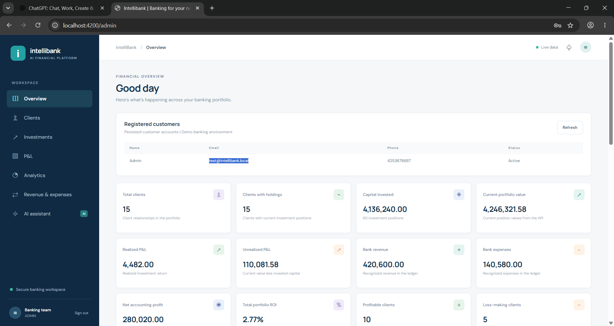
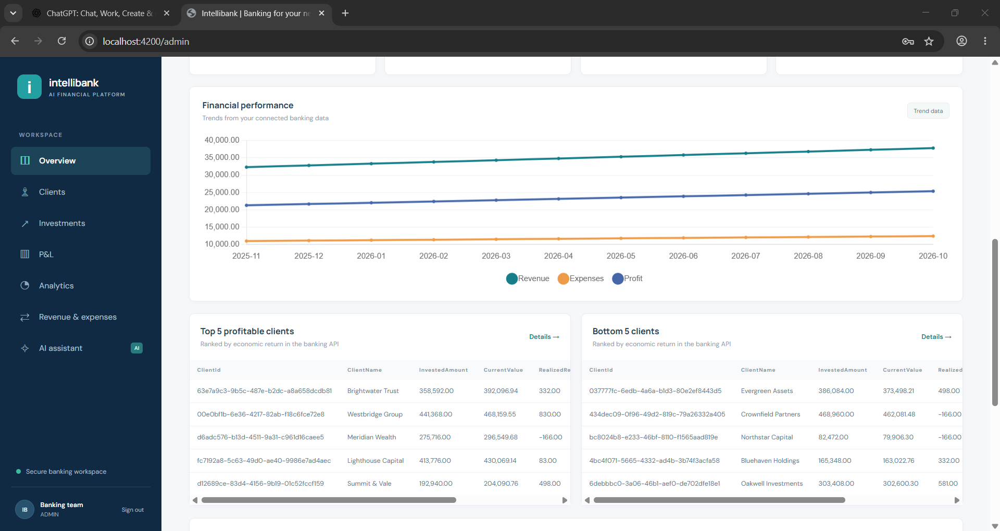
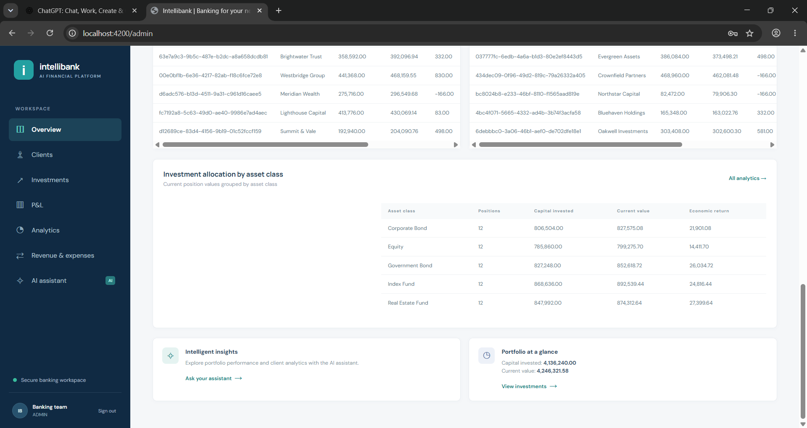

# IntelliBank AI

IntelliBank AI is a local, synthetic-data investment banking portfolio and client-profitability simulation. It brings together a Spring Boot banking API, an Angular dashboard, read-only MCP tools, and a local AI assistant integration. It does not trade, move money, or provide personalized investment advice.

> **Scope note:** this is a development/demo application, not a production banking system. Use only synthetic data. Do not expose it to the public internet.

## Project layout

```text
backend/       Spring Boot REST API, persistence, analytics and seeded data
frontend/      Angular single-page application and Nginx container
mcp-server/    Read-only MCP tools backed by the REST API
ai-service/    Chat/tool orchestration and reusable AI skills
docs/          Architecture, data model, tool catalog and setup notes
docker-compose.yml
```

## Quick start

### Docker Compose

Prerequisites: Docker Desktop with Compose v2, and 8 GB of available memory for the application and optional local model. Published ports are bound to loopback for local-only access. PostgreSQL and the API are available to host tools at `localhost:5433` and `localhost:8081` by default. Set `POSTGRES_HOST_PORT` or `BACKEND_HOST_PORT` in `.env` to change their host ports.

1. Copy `.env.example` to `.env` and change the local-only passwords/secrets.
2. Start the application:

   ```powershell
   docker compose up --build -d
   ```

3. Open the frontend at <http://localhost:4200> and the API's OpenAPI UI at <http://localhost:8081/swagger-ui/index.html>.
4. Sign in using `admin@intellibank.local` / `Admin123!` for local development (or a role-specific account listed in [backend/README.md](backend/README.md)). Change demo passwords in `.env` before sharing the environment.
5. To enable local Ollama terminology explanations, set `OLLAMA_ENABLED=true` in `.env`, start/recreate the AI and Ollama services, and pull the configured model:

   ```powershell
   docker compose --profile local-llm up -d ai-service ollama
   docker compose exec ollama ollama pull llama3.2:3b
   ```

   Ollama is optional; quantitative chat questions use deterministic backend API routing and never depend on a paid provider or API key.
6. Stop the stack with `docker compose down`. Add `-v` only when you intentionally want to remove local database/model data.

### Run components independently

- **Backend:** `cd backend; mvn spring-boot:run`. The default configuration uses local H2. See [backend/README.md](backend/README.md).
- **Frontend:** `cd frontend; npm ci --legacy-peer-deps; npm start`. See [frontend/README.md](frontend/README.md).
- **MCP server / AI service:** see the module-specific README files and configure the banking API base URL and read-only service credentials. MCP tools are read-only and retrieve their data from the REST API.
- **PostgreSQL:** use the Compose service or configure the backend datasource through environment variables.

### Render deployment

Deploy the backend and PostgreSQL first, then deploy `frontend/` as a Docker web service using `frontend/Dockerfile`. Set the frontend service's `BACKEND_URL` environment variable to the backend's Render URL, including its scheme (for example, `https://your-backend.onrender.com`) and without a trailing slash. The frontend Nginx container substitutes this value at startup; Docker Compose continues to use its internal `backend` hostname. Set `AI_SERVICE_URL` to the AI service URL if deploying the assistant; otherwise the assistant API remains unavailable, but the frontend itself can start. Do not use `backend` as the Render URL.

## What is included

- Synthetic clients, investments, historical values, revenue and expenses.
- Client and investment workflows and portfolio/P&L dashboards.
- Backend-calculated bank/client profitability, returns, and client/sector rankings.
- Read-only MCP tool access to the banking API and an AI assistant integration.
- OpenAPI documentation and local PostgreSQL/Ollama Compose configuration.

Amounts and KPIs must be fetched from the banking API; the frontend must not treat sample placeholders as financial facts. Unrealized P&L is reported separately from accounting net profit. Forecasts and generated explanations are not guaranteed outcomes.

## API overview

The versioned API base path is `/api/v1`. The principal routes include:

| Route | Purpose |
|---|---|
| `GET/POST /clients`, `GET/PUT /clients/{id}` | Client list, create, detail and update |
| `GET/POST /investments`, `GET/PUT /investments/{id}` | Investment list and management |
| `GET /investments/client/{clientId}` | Client investment holdings |
| `GET/POST /revenues`, `GET/POST /expenses` | Record and list recognized income/costs |
| `GET /reports/bank/pnl`, `GET /clients/{id}/pnl` | Bank and client financial metrics |
| `GET /analytics/top-clients`, `/bottom-clients`, `/portfolio` | Server-calculated portfolio analytics |
| `GET /dashboard/summary`, `/dashboard/trends` | Dashboard metrics and time series |
| `POST /api/assistant/chat` | Authenticated assistant request through the frontend proxy |

Check Swagger UI for exact request/response schemas and currently supported query filters.

## Validation

Run backend checks from `backend/` with `mvn test`, MCP/AI checks in their module directories with `mvn test`, and frontend checks from `frontend/` with `npm ci --legacy-peer-deps; npm run build`. Run `docker compose config` to validate the Compose file before startup.

Java tests and Angular production build passed in the current development environment. Docker is unavailable here, so the container images and full Compose runtime remain unverified.

## Documentation

- [Architecture and service flow](docs/architecture.md)
- [Relational data model](docs/data-model.md)
- [MCP tool catalog](docs/mcp-tools.md)
- [AI skills](docs/ai-skills.md)
- [REST API examples](docs/rest-api.md)
- [Implementation and validation checklist](docs/progress.md)
- [Backend setup and API details](backend/README.md)
- [Frontend setup](frontend/README.md)

## Public and customer portal

See [customer portal setup, database migration and deployment limits](docs/customer-portal.md) for the new landing page, sign-up/sign-in flows, customer profile storage and hardened configuration baseline.






