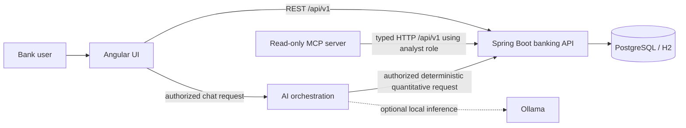

# Architecture

IntelliBank AI is organized as a banking-domain Spring Boot application with independently runnable Angular, MCP and AI components. The banking API is the source of truth for persisted data and deterministic financial calculations.

Quantitative answers must be based on the backend/MCP response. The model is for language interpretation and explanation only; it must not calculate authoritative accounting values, issue transactions, or access the database directly. MCP operations are read-only.

## Responsibilities

- **Banking API:** validation, client and investment workflows, revenue/expense records, synthetic market/valuation history, authorization, audit trail and BigDecimal calculations.
- **Database:** relational persistence, constraints and migration history; H2 supports lightweight local development and PostgreSQL is the Compose database.
- **Angular:** presents API-provided data, interactive filters and visualizations; no authoritative financial figures are embedded in UI code.
- **MCP server:** exposes typed, bounded tools and calls the API over HTTP using a configured read-only service account. It does not query storage itself.
- **AI service:** deterministically routes quantitative chat questions to backend APIs using the user's bearer token. Optional Ollama inference is limited to general terminology explanations and requires a separately downloaded model.

## Financial metric boundaries

Accounting net profit uses recognized revenue minus recognized expenses. Realized and unrealized investment P&L are separate. Total economic return combines investment P&L/income and attributable costs; unrealized gains are not recognized as accounting revenue by default. Monetary arithmetic uses decimal values and explicit rounding in the backend.

## Local deployment

The Compose file starts PostgreSQL, the banking API, MCP service, AI service and frontend. The `local-llm` profile adds Ollama. Published ports are loopback-only; service configuration is supplied by environment variables, and development values in `.env.example` must be replaced before any shared deployment.
