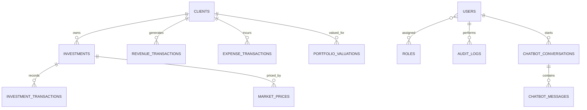

# Data model

The relational model is centered on client relationships and bank-owned investment positions. Migrations under `backend/src/main/resources/db/migration/` define the schema; consult those migrations for the current authoritative columns and constraints.

Expected domain concepts include users and roles, clients, investments, transactions, synthetic market prices, revenue and expense transactions, portfolio valuation history, FX rates, chat conversations/messages, and audit events. Client/investment ownership is enforced through relational references; database migrations are the source of truth where conceptual entities differ from the current implementation.

### Accounting conventions

- Store amounts as fixed-precision decimal values, never binary floating-point.
- Preserve transaction and valuation dates for historical reporting.
- Do not recognize unrealized gains as accounting revenue by default.
- Prevent investment sale gains/losses from being counted a second time as general revenue/expense.
- Use synthetic and clearly labeled FX/market observations only.
